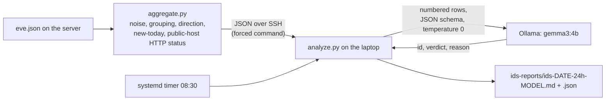

# AI Alert Triage: Suricata + a Local LLM

> Status: 🟢 **Running.** The daily report is produced by a systemd timer on the GPU laptop node. The honest limits of the model's contribution are in [What the model adds (and what it does not)](#what-the-model-adds-and-what-it-does-not).

Runs on the control-plane node (`<HOSTNAME>`, aggregator) and the GPU laptop node (`<GPU_HOSTNAME>`, analyzer + Ollama — RTX 3050 Ti, 4 GB VRAM).

Ollama and the timer run **directly on the laptop under systemd, not as Kubernetes workloads**. The same machine is labeled and tainted for GPU/AI pods in [Dedicated GPU Node](./SRV-17-Dedicated-GPU-Node.md); that namespace and quota are unrelated to this pipeline and still unused.

Problems hit during this work are recorded separately in [SRV-27-TRBL](../troubleshooting/SRV-27-TRBL-AI-Alert-Triage.md).

## Contents

1. [Goal](#goal)
2. [Design rule: code computes, the model only narrates](#design-rule-code-computes-the-model-only-narrates)
3. [Architecture](#architecture)
4. [Step 1 — The aggregator](#step-1--the-aggregator)
5. [Step 2 — The analyzer](#step-2--the-analyzer)
6. [Step 3 — Deployment](#step-3--deployment)
7. [Step 4 — Choosing the model](#step-4--choosing-the-model)
8. [What the model adds (and what it does not)](#what-the-model-adds-and-what-it-does-not)
9. [Security considerations](#security-considerations)
10. [Case study: a new public web server appears](#case-study-a-new-public-web-server-appears)
11. [Operating cheat-sheet](#operating-cheat-sheet)
12. [Known limitations and next steps](#known-limitations-and-next-steps)

## Goal

Turn the raw [Suricata](./SRV-26-Suricata-IDS.md) alert stream (about 6,000 alerts per day, almost all of it harmless) into a short daily report that says what is new, what needs attention, and what the public-facing host received — without sending private traffic to a cloud service.

## Design rule: code computes, the model only narrates

Early experiments asked small local models to copy and summarise a table of alert counts. Every model tried corrupted or invented numbers, and the reasoning-style model wrote its thinking instead of an answer — see [SRV-27-TRBL](../troubleshooting/SRV-27-TRBL-AI-Alert-Triage.md#small-models-corrupt-numbers-they-are-asked-to-copy). The pipeline was therefore designed so the model never handles a number:

1. **Code** parses the logs, labels known noise, counts, groups, and computes direction, novelty and server responses.
2. **The model** sees only numbered rows of what is left and returns a strict JSON verdict per row (`id`, `verdict`, one-sentence `reason`).
3. **Code** validates the answer (ids must belong to the batch, verdict must be one of three values), merges it with the computed facts, applies safety rules, and writes the report.

## Architecture



| Component | Host | Role |
|---|---|---|
| `aggregate.py` | server | Reads `eve.json*` (including rotated `.gz`), prints one JSON summary. Python 3 standard library only |
| `devices.json` | server | IP or subnet → human name, optional `"role": "public"` |
| `analyze.py` | laptop | Fetches the summary, queries Ollama, validates, writes Markdown + JSON reports |
| Ollama + model | laptop | Local inference on the GPU |
| `ids-report.timer` / `.service` | laptop | Daily run, catches up after a missed run |
| Restricted SSH key | both | The laptop may run exactly one command on the server |

Both scripts and the unit files are kept in [`server/ai-triage/`](./ai-triage/).

## Step 1 — The aggregator

```
python3 ~/ai/aggregate.py --hours 24            # JSON for the analyzer
python3 ~/ai/aggregate.py --hours 24 --text     # human-readable table
python3 ~/ai/aggregate.py --hours 720 --detail 'REGEX' --limit 40   # raw alerts of matching signatures
```

| Option | Meaning |
|---|---|
| `--hours` | Window length (default 24) |
| `--baseline-days` | Days before the window used to decide whether a signature is *new* (default 7) |
| `--max-rows` | Cap on reviewed signatures (default 40) |
| `--devices`, `--log-dir` | Paths to `devices.json` and the Suricata log directory |
| `--detail REGEX` | Print matching raw alerts instead of the summary |

What it does, in order:

1. **Known noise** is matched by signature regex (optionally also by domain or User-Agent) and only *counted* per group: SURICATA decoder anomalies, STUN, Discord, OpenAI, APT, Spotify, Steam, connectivity checks, Telegram, GitHub assets, DoH, the `.onion` probe, Windows Update. A User-Agent rule is used only for exact signature pairs, because a User-Agent can be forged.
2. **Public hosts** (`"role": "public"` in `devices.json`): inbound alerts against them are collapsed into per-signature counters, and their HTTP response codes are read from Suricata `http` events. A 2xx answer for a sensitive path (`.env`, `.git`, `phpinfo`, `wp-config`, backups, dumps, keys, config files) is reported as **ANSWERED**. Alerts the public host *itself originates* are flagged **priority**.
3. **Everything else** is grouped by signature and enriched with severity, count, top local hosts (with names), top peers (domain or IP), dominant direction (`inbound` = Internet → local, `outbound` = local → Internet, `internal` = both local), destination ports, protocol, and **new** (signature not seen in the previous `--baseline-days`).

Direction is normalised: for response packets the *server* is the source address, so the "host" column is always the private-side address.

`devices.json` (template: [`ai-triage/devices.example.json`](./ai-triage/devices.example.json)):
```json
{
  "<SERVER_IP>": "Control-plane node",
  "<GPU_IP>": "GPU laptop node",
  "<PUBLIC_HOST_IP>": { "name": "Public web server", "role": "public" },
  "<USERS_SUBNET>.0/24": "Users VLAN device"
}
```
Plain string values and `{name, role}` objects can be mixed; subnets (CIDR) are allowed as keys. Validate with `python3 -m json.tool`; a stray trailing comma makes the aggregator stop with a clear message.

The real `devices.json` holds internal addresses and device names and is gitignored.

## Step 2 — The analyzer

```
python3 ~/ids/analyze.py --ssh-key ~/.ssh/ids_report --model gemma3:4b --lang ru
python3 ~/ids/analyze.py --input summary.json --model qwen2.5:3b      # offline: use a saved summary
```

Pipeline:

1. **Fetch** the 24 h summary over SSH (`BatchMode`, restricted key), or read `--input`.
2. **Batch** rows: at most 8 rows and 5,000 characters of prompt data per request.
3. **Ask Ollama** (`/api/chat`): `temperature 0`, JSON-schema `format`, `num_ctx 4096`, `num_predict = 110 × rows + 100`, 240 s timeout per request. The system prompt describes the network, the row fields and the three verdicts: `benign`, `worth_a_look`, `suspicious`.
4. **Validate**: ids must belong to the batch, the first answer for an id wins, the verdict must be in the enum, text is stripped of control characters and angle brackets and truncated.
5. **Retry** rows the model skipped or whose batch failed, in smaller batches (8 → 2 → 1), at most 3 passes, within a 900 s total budget. Rows that never get a valid answer are shown as `unreviewed` rather than guessed.
6. **Guard (code overrides the model):** a row can never end as `benign` if it has severity 1, is flagged priority, or belongs to an attack/threat-intel family (`ET DROP|CINS|SCAN|EXPLOIT|MALWARE|TROJAN|CNC|ADWARE_PUP|PHISHING|WEB_SERVER|WEB_SPECIFIC_APPS`). It becomes `worth_a_look` with the note `[raised by code: …]`.
7. **Sort and write**: priority first, then new, then severity, then count. Output is `~/ids-reports/ids-<date>-<hours>h-<model>.md` and `.json`.
8. **Exit code 3** if the model produced nothing usable, so the systemd unit shows as failed instead of silently writing an empty report.

Report sections: a summary line (window, alert totals, noise percentage, verdict counts, model, time, tokens/s); an **ATTENTION** line if a public host answered a sensitive path with 2xx; the alerts table (verdict, severity, count, flags, signature, devices, peers, reason); one **Public host** section (request count, response-code histogram, inbound alert counters, sensitive-path answers); the known-noise table; devices without a name; and a reminder of the sensor's blind spots.

## Step 3 — Deployment

### Restricted SSH key (laptop → server)

On the laptop:
```
ssh-keygen -t ed25519 -f ~/.ssh/ids_report -N "" -C "ids-report@laptop"
cat ~/.ssh/ids_report.pub
```
On the server, append one line to `~/.ssh/authorized_keys`:
```
command="python3 /home/<USERNAME>/ai/aggregate.py --hours 24",no-pty,no-port-forwarding,no-agent-forwarding,no-X11-forwarding ssh-ed25519 AAAA… ids-report@laptop
```
`command=` pins the key to a single command, whatever the client asks to run, so a stolen key can only produce the 24 h summary. The key has no passphrase because the timer must run unattended; the summary contains internal IPs and device names, so protect the key like any other credential.

Test from the laptop — this must print the start of the JSON, not the output of `id`:
```
ssh -i ~/.ssh/ids_report -o IdentitiesOnly=yes <USERNAME>@<SERVER_IP> id | head
```

### Daily timer (laptop)

`/etc/systemd/system/ids-report.service` and `ids-report.timer` are kept in [`ai-triage/`](./ai-triage/):

```ini
[Service]
Type=oneshot
User=<USERNAME>
ExecStart=/usr/bin/python3 /home/<USERNAME>/ids/analyze.py --ssh-key /home/<USERNAME>/.ssh/ids_report --model gemma3:4b --lang ru
TimeoutStartSec=1200
```

```
sudo systemctl daemon-reload
sudo systemctl enable --now ids-report.timer
sudo systemctl start ids-report.service        # one test run (about a minute)
journalctl -u ids-report.service -n 15 --no-pager
systemctl list-timers ids-report.timer
```

`Persistent=true` in the timer runs a missed job at the next boot — relevant here because the laptop is not always on. `--lang ru` makes the model's one-line reasons Russian; the default is English.

## Step 4 — Choosing the model

Test: the 30-day summary (40 signature rows) on the 4 GB GPU, same prompt and protocol for each model.

| Model | Time | Speed | Verdicts (suspicious / worth a look / benign) | Observation |
|---|---|---|---|---|
| qwen2.5:3b | 24 s | 78 tok/s | 2 / 34 / 4 | Fast, but hardly separates anything; flagged a file-hosting domain as suspicious while rating HeartBleed only "worth a look" |
| phi4-mini | 33 s | 42 tok/s | 21 / 5 / 14 | Alarmist and inconsistent (`.life` suspicious, `.biz` fine); marked every item already triaged by hand as suspicious |
| **gemma3:4b** | 69 s | 27 tok/s | 2 / 33 / 5 | Most restrained: "suspicious" only on the two attack-style rows (HeartBleed, Zmap scan). Slowest, likely partly offloaded to the CPU (not verified) |

`qwen3:4b` was excluded earlier for printing its reasoning instead of keeping to the output format. **gemma3:4b was chosen for restraint.** A daily run takes about a minute. On a 4 GB card `ollama ps` should show `100% GPU`; a split such as `14%/86% CPU/GPU` means part of the model spilled to system memory.

## What the model adds (and what it does not)

Measured honestly: most reviewed rows still end up `worth_a_look`, and the reasons often paraphrase the signature name. The value of the system is in the code around the model:

- 99% of alerts removed as known noise before anything is reviewed;
- inbound internet scanning of the public host counted and separated from alerts that matter;
- server response codes checked mechanically (the question "did it answer?" is never left to the model);
- *new today* and *priority* flags that put the unusual first;
- a guard that stops the model from calling attack-family alerts benign.

The model's role is a short plain-language explanation per row. It is not a decision maker, and the docs, report and code treat it that way.

## Security considerations

- **Alert text comes from network traffic and is untrusted** — a hostile domain name can contain instructions. It is wrapped in `<data>`, stripped of control characters and angle brackets, length-limited, and the prompt tells the model never to follow instructions found inside it. The model has no tools and no network access.
- **Residual risk:** a crafted string can still push the verdict of an *unguarded* row toward `benign`. That is why counts, response-code checks and the guard do not depend on the model.
- The SSH key is restricted to one read-only command (above).
- `devices.json` and the generated reports contain real internal addresses and names; they are gitignored and never committed.

## Case study: a new public web server appears

> 🟡 This section describes a host set up for a friend's website. The documented public path is now a Gateway **inside the cluster** ([Public Port Forwarding](../network/NET-09-Public-Port-Forwarding.md), [Public Gateway and HTTPS](./SRV-23-Public-Gateway-and-HTTPS.md)), not a separate machine; whether the host below is that same site is **not yet confirmed**. The isolation work it prompted is planned in [DMZ VLAN Plan](../network/NET-10-DMZ-VLAN-Plan.md).

A port forward was added on the router for ports 80/443 to a host on the LAN. The same evening the IDS reported inbound alerts to that host: reputation-list sources (`ET DROP Dshield`, `ET CINS`), a GraphQL introspection probe, repeated requests for `/.env`, `phpinfo`, `wp-config` backups and a WordPress-plugin REST path, from well-known internet scanners. The previous 14 days of logs contained none of this.

What the pipeline established:

1. Inbound scanning was collapsed into counters — hundreds of requests from a few dozen addresses in 24 h.
2. Response codes came from Suricata `http` events: nearly all probes got `404`; the only `2xx` answers were Let's Encrypt `/.well-known/acme-challenge/` validations and the home page. **No sensitive path was answered.**
3. Finding: the public address sits in the **Admin VLAN**, next to the cluster and management machines, so a compromise of the site would start inside the trusted network. Mitigation designed in [DMZ VLAN Plan](../network/NET-10-DMZ-VLAN-Plan.md) — a dedicated DMZ VLAN allowing DMZ → internet and Admin → DMZ, denying DMZ → Users/Admin.
4. Limit: once the site serves HTTPS, response codes become invisible to the IDS and the web server's access log must be used instead.

## Operating cheat-sheet

```
python3 ~/ai/aggregate.py --hours 24 --text | less            # server: today's summary
python3 ~/ai/aggregate.py --hours 720 --detail 'Zmap|CINS'     # server: raw alerts for a signature family
ls -lt ~/ids-reports | head                                    # laptop: latest reports
systemctl list-timers ids-report.timer                         # laptop: next run
```

- **A signature is confirmed harmless** → add a rule to the `NOISE` list in `aggregate.py` (signature regex, optional domain regex, group name). Prefer narrow rules; never whitelist a whole family because of one false positive.
- **A new device appears as `unknown`** → add it to `devices.json` (a DHCP reservation keeps its address stable).
- **Compare models** → run `analyze.py --input <summary.json> --model <name>` for each model on the same saved summary.

Suricata and the server log in UTC; report times are in the clock of the machine that prints them, and the timer uses the laptop's local time.

## Known limitations and next steps

- Most verdicts are generic `worth_a_look`; a `reviewed.json` memory of human decisions would let the report show only what is new or changed.
- HTTPS on the public host will hide response codes; add web-server access-log checks.
- Move the public site behind a DMZ VLAN — designed, not applied: [DMZ VLAN Plan](../network/NET-10-DMZ-VLAN-Plan.md).
- Report delivery is a file on the laptop; push notifications or e-mail are not set up. The cluster already routes alerts to Slack ([Alerting Reliability](./SRV-22-Alerting-Reliability.md)), which is the obvious place to send this too.
- The "priority" rule also fires for response-direction alerts from the public host; tune after more observation.

## Related

- [SRV-27-TRBL](../troubleshooting/SRV-27-TRBL-AI-Alert-Triage.md) — troubleshooting for this doc
- [Suricata IDS](./SRV-26-Suricata-IDS.md) — the sensor that produces the alerts
- [Node Profile — GPU Laptop Worker](./SRV-11-GPU-Laptop-Node-Profile.md) — the machine running Ollama
- [Dedicated GPU Node](./SRV-17-Dedicated-GPU-Node.md) — the Kubernetes side of the same machine
- [Traffic Monitoring](../network/NET-08-Monitoring.md) — the port mirror that feeds the sensor
- Guide: [LLM Triage Design](https://github.com/MrSandwick/OVault/blob/main/homelab-docs/homelab-guides/server/decisions/Guide-LLM-Triage-Design.md)
- Guide: [Reading Suricata Alerts](https://github.com/MrSandwick/OVault/blob/main/homelab-docs/homelab-guides/network/operations/Guide-Reading-Suricata-Alerts.md)
